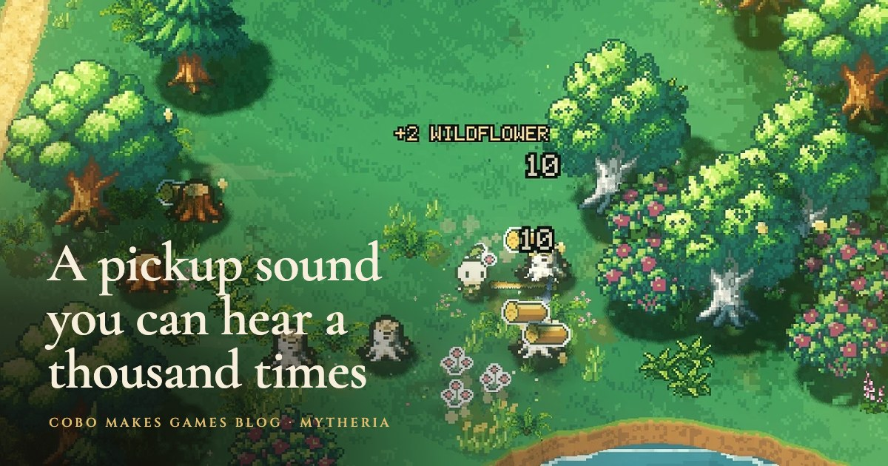

# Shuffle SFX for Godot 4



Sound effects you can hear a thousand times. Give a sound a few recordings and Shuffle SFX plays them in a shuffled order that never repeats the last one, skips plays that come too close together, caps how many of one sound play at once, and keeps a few voices free for the sounds that matter.

It's the sound player from [Mytheria](https://cobomakesgames.com/mytheria/), our pixel-art co-op game. Why each rule is there, with a fight you can listen to, is in [a pickup sound you can hear a thousand times](https://cobomakesgames.com/blog/pickup-sound/) and [game sound effects](https://cobomakesgames.com/blog/game-sound-effects/).

## What it does

- Plays every recording of a sound once before any repeats, like dealing from a shuffled deck, and never the same one twice in a row. Picking at random repeats more than you'd think: with eleven recordings, about one play in eleven is a repeat.
- Skips a play that lands inside the sound's cooldown, so four stones landing in your bag at once sound like a few soft plops instead of one loud click.
- Limits how many copies of one sound play at the same time.
- Keeps some voices for important sounds. Ordinary sounds can't use them, so in a busy fight the sound that tells you you've been hit still plays.
- Optional pitch spread per sound, in cents. Mytheria's pickup uses none and gets its variety from the recordings.

## Install

Copy `addons/shuffle_sfx` into your project's `addons` folder, then enable **Shuffle SFX** under Project Settings > Plugins. It works with Godot 4.3 and later (tested on 4.6 and 4.7).

## Use

Add a `ShuffleSfxPlayer` node, give it one `ShuffleSfxCue` per sound in the inspector, then play by id:

```gdscript
@onready var sfx: ShuffleSfxPlayer = $Sfx

func _on_item_collected() -> void:
	sfx.play(&"pickup")
```

A cue has:

| Setting | What it does | Mytheria's pickup |
|---|---|---|
| `id` | The name you play it by | `pickup` |
| `variants` | The recordings | 11 |
| `cooldown` | Seconds before the next play of this sound is allowed | 0.09 |
| `max_voices` | How many may sound at once | 2 |
| `priority` | At or above the player's `important_priority`, it may use reserved voices | 0 |
| `volume_db`, `pitch_cents`, `bus` | Level, random pitch spread either way, and the audio bus | |

The player has `voices` (24 by default), `reserved_voices` (4) and `important_priority` (4), plus a `seed` for a repeatable order.

`play()` returns `false` when it skips, and the `dropped(id, reason)` signal says why: `unknown`, `cooldown`, `voices` or `budget`. `check(id)` tells you whether a play would happen without playing it, and `stats()` counts plays and skips.

`ShuffleBag` works on its own too, for anything you want dealt without back-to-back repeats:

```gdscript
var bag := ShuffleBag.new(tips.size())
show_tip(tips[bag.next()])
```

## Demo and tests

Open the project in this repository and run it: the demo makes five plop sounds in code, so it ships no recordings. Run the checks with:

```
godot --headless --path . --script tests/test_shuffle_sfx.gd
```

## License

MIT, by [Cobo Makes Games](https://cobomakesgames.com). If it helps your game, we'd love to hear about it.
